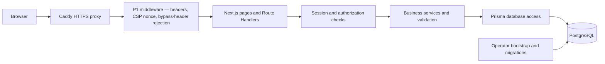

# Design Document

Team #13

This document describes the planned secure incident-reporting application and supports SDL Practice #5. The assignment governs functional and security behavior. OWASP ASVS 5.0.0 Level 2 supplements those requirements. The developer approved the reviewer-supplied design answers on 2026-11-18. Implementation and verification are pending for the application features described here. [Assignment](../ASSIGNMENT.md) · [Security requirement mapping](asvs/assignment-mapping.md)

## 1. Scope and decisions

The application provides a reporter workflow, a reviewer workflow, and administrator controls for accounts, incident visibility, comments, bounded settings, and categories. It uses Next.js App Router with TypeScript and PostgreSQL. The course deployment runs in Docker. AWS remains a future deployment target. The existing threat model defines the role permissions and entry points used throughout this design. [Architecture decisions and entry points](threat-model.md)

Prisma ORM is selected for database access under the delegated ORM decision. Its typed query interface fits the TypeScript application, and transactions support atomic business changes with audit records. Queries must use ORM calls or bound parameters. Ban `$queryRawUnsafe` and `$executeRawUnsafe` through lint or CI checks (SR-8, ASVS V1.2.4). Authorization remains explicit in the application, including filters on records and selected response fields. Reviewed migration SQL will be needed for PostgreSQL audit permissions and triggers. The runtime target is Node 24 LTS, recorded in package engines and `.nvmrc`. Use the latest supported Prisma 7.x release with `@prisma/adapter-pg` and `pg`, pinned to exact versions when implemented. Confirm package releases with `npm view`. Pin the Node 24 container image and `postgres:18-alpine` image by digest. Record the resolved versions and digests with the implementation. [Prisma query safety](https://www.prisma.io/docs/orm/v7/prisma-client/using-raw-sql/raw-queries) · [Prisma transactions](https://www.prisma.io/docs/orm/v7/prisma-client/queries/transactions)

Caddy is selected as the local HTTPS reverse proxy, as directed by the team. The local endpoint is `https://localhost`, with Caddy `tls internal` and its root certificate trusted through `caddy trust`. Caddy forwards to Next.js over HTTP on the private Docker network. This internal plaintext hop is accepted as AR-8 in the STRIDE risk register. The app accepts traffic only through Caddy and trusts exactly one proxy hop (`TRUSTED_PROXY_HOPS=1`), using the rightmost `X-Forwarded-For` value supplied by that proxy.

## 2. Architecture and responsibilities

| Component | Responsibility |
|---|---|
| Browser UI | Role-specific navigation, forms, readable validation feedback, and logout access. Render incident text as escaped text. |
| Caddy | Local HTTPS entry point and reverse proxy. Forward client identity only through the trusted proxy path. |
| Middleware (P1, FW-1) | Set security headers and a CSP nonce. Reject requests carrying `x-middleware-subrequest`. |
| Framework surfaces (FW-3 to FW-5) | Prohibit Server Actions, disable the image optimizer, and provide generic error pages with `poweredByHeader: false`. |
| Pages and Route Handlers | Authenticate and authorize each request, including page and RSC reads. Route Handlers own all writes. |
| Session and authorization logic | Resolve the hashed session token, account activity, expiry, current database role, and temporary-password gate. |
| Business services | Enforce validation, incident transitions, account protections, and transactional audit recording. |
| Prisma access layer | Parameterized data access, ownership and status filters, explicit field selection, and transactions. |
| PostgreSQL | Persist application data, relationships, concurrent changes, sessions, and append-only audit history. |
| Operator tools | Bootstrap the first administrator, apply migrations with a separate database owner role, and manage deployment secrets. |

The browser, application, database, and operator plane cross the trust boundaries already documented in the threat model. Input is untrusted until validated at the server. Database credentials for normal operation have restricted permissions. The application must authorize requests independently of middleware. [Trust boundaries and common controls](threat-model.md#12-trust-boundaries)

## 3. Roles and interfaces

| Capability | User | Reviewer | Admin | Entry points |
|---|---|---|---|---|
| Sign in, sign out, change own password | Allowed | Allowed | Allowed | EP-01, EP-02, EP-05, EP-06 |
| Submit an incident | Allowed | Denied | Denied | EP-07 |
| View own report summaries | Allowed | Denied | Denied | EP-19 |
| View incident queue and details | Own summaries only | Open and under-review | All statuses | EP-08, EP-09, EP-19 |
| Change status or classification | Denied | Allowed for accessible incidents | Denied | EP-10, EP-21 |
| Add comments | Denied | Accessible incidents | All incidents | EP-11 |
| Manage accounts and roles | Denied | Denied | Allowed with account safeguards | EP-12 to EP-17 |
| Read audit history | Denied | Denied | Allowed | EP-18 |
| Manage settings and categories | Denied | Denied | Allowed | EP-20, EP-22, EP-23 |

The role matrix follows D-1 to D-3. A user sees title, status, and submission date for their own reports. Reviewers lose access to closed incidents. Administrators can view and comment across statuses. All accounts are prohibited from changing their own role. Account administration also prevents self-deactivation and removal of the last active administrator. [Entry point contracts](threat-model.md#14-entry-point-inventory)

Public interfaces are login, the minimal health endpoint, and static assets (EP-01 to EP-04). Protected requests require a valid active-account session. Missing or invalid sessions redirect pages to `/login` and yield 401 at the API. Role-based denials yield 403, and inaccessible incident details use the same 404 response as missing records. Unsupported methods yield 405. API errors use `{error:{code,message,fields?,requestId}}`. Optional field feedback is limited to safe validation messages. Diagnostic details belong in sanitized server logs.

Server Actions are prohibited. The image optimizer is disabled with `images.unoptimized`. Custom error and not-found pages provide generic feedback. Each route exports only allowed methods, and page/RSC reads run authorization checks (FW-1 to FW-6).

Unknown-username lockout is counted by submitted name even when the account does not exist. Database counters use scope, key, and window start so both IP and username state have persistent storage.

## 4. Data model

The following logical model preserves the stores already identified by the threat model. The approved physical design uses UUID entity primary keys, PostgreSQL enums for role and status, and `timestamptz` for timestamps.

| Store | Core data and relationships | Protection |
|---|---|---|
| Users | ID, username, fixed role, active flag, password hash, temporary-password expiry and change flag | Password hashes stay server-side. Role and activity are read for authorization. |
| Sessions | Token hash, user reference, creation, last activity, absolute expiry | Only an opaque random token is held in the browser cookie. |
| Incidents | ID, reporter reference, title, description, status, category reference, timestamps | Queries constrain ownership and reviewer status visibility. |
| Comments | ID, incident reference, author reference, body, creation time | Access follows the parent incident's authorization. |
| Categories | ID, unique name, active flag | Deactivation preserves existing assignments and prevents new assignments. |
| Settings | Bounded configuration, update time, updating actor | Validate on write and read. Invalid stored values use fixed defaults. |
| Audit log | ID, actor, UTC time, action, target | Append-only database permissions and an update/delete rejection trigger. |
| Login attempts | Scope (ip or username), key, time window, count and lockout expiry | Supports shared rate limits across restarts and application instances. |

Incident identifiers are UUIDs as recorded in the threat model. Passwords, session tokens, and secrets are highly sensitive. Descriptions, comments, and roles require restricted access. Lists select only necessary fields and omit descriptions. The first-admin audit actor is `system`, represented by `actor_type = system` with no user ID (DC-3, NH-4). Audit records use `actor_type` (user or system) and nullable `user_id`, with a CHECK requiring a user ID for user actors and no user ID for system actors. Allowlisted `details jsonb` is used only by `settings.update` and stores `{key:{old,new}}`. [Assets and data sensitivity](threat-model.md#17-assets-and-data-stores)

Foreign keys use RESTRICT except the sessions-to-users relationship, which uses CASCADE. Application permissions still limit deletion to session and login-attempt cleanup. Normalize usernames once using NFKC and lowercase before validation and account lookup, with the accepted pattern `^[a-z0-9._-]{3,32}$`. Enforce uniqueness on normalized usernames, `lower(category.name)`, and `sessions.token_hash` (SR-7, SR-8, ASVS V1.1.1, V2.2.1).

Create indexes on `sessions(user_id)`, `sessions(expires_at)`, `incidents(status,created_at)`, `incidents(reporter_id,created_at)`, `comments(incident_id,created_at)`, `audit_log(created_at)`, and `audit_log(user_id)`. Login-attempt counters retain their unique scope/key/window-start constraint.

## 5. Main workflows and consistency

Account creation generates a one-time temporary password, displays it once, and records account creation. First login requires a password change. The temporary-password session is restricted to the password flow, logout, and static assets. Self-service password change requires the current password and offers to end other sessions, selected by default. Admin reset and account deactivation end all target sessions.

Login uses a new 256-bit CSPRNG session token whose SHA-256 hash is stored server-side. The session hash is stored in PostgreSQL (ASVS V7.2.3). The cookie uses the `__Host-` prefix, `HttpOnly`, `Secure`, `SameSite=Strict`, and `Path=/`. The design limits accounts to five sessions and ends the oldest at the limit. Default inactivity and maximum lifetimes are 30 minutes and eight hours. Logout deletes the server session and expires the browser cookie. [Session policy D-5](threat-model.md#step-3-what-can-be-done-about-it-mitigations-and-ranking)

An incident begins open and is attributed to the authenticated reporter. Reviewers classify it with an active category, comment, and move it through open → under-review → closed. Each mutation checks the current role and record permissions. Status changes use the expected existing status to reject conflicting updates.

FR-11 actions and the additional settings/category actions commit with their audit record in one transaction. Audit failure rolls back the business mutation. Last-administrator protections must remain correct under concurrent requests. Use interactive Serializable transactions for role changes, deactivation, and session-cap eviction. Read the relevant account/session state and perform the guarded mutation and audit insert in that transaction. Retry the entire transaction at most three times on Prisma P2034 with jitter, then return a generic 409. Temporary-password consumption uses a conditional `updateMany` whose affected count must be exactly one. The required-password-change gate remains active until replacement succeeds. Expected-status checks and uniqueness constraints reject conflicting repeated writes. Repeated creates and comments can produce visible duplicates because the approved design omits idempotency keys (NFR-5, ASVS V2.3.3, V2.3.4).

## 6. Validation, security, and error handling

Use Zod strict object schemas to reject unknown fields, invalid types, unsupported enums, and out-of-range values. Passwords retain the 15–128 character policy. A shared JSON parser caps request bodies at 64 KB. Lists default to 25 records and allow at most 100 per page. Plain text is escaped at rendering. Queries use ORM operations or bound parameters (SR-7, SR-8, ASVS V2.2.1, V2.2.2, V1.2.4).

| Input | Accepted character length |
|---|---|
| Incident title | 1–200 |
| Incident description | 1–10,000 |
| Comment | 1–5,000 |
| Category name | 1–50 |
| Public status message | 0–280 |

Use `argon2` (node-argon2) with argon2id, memory 19,456 KiB, two iterations, and parallelism one. These are the approved starting parameters. Increase them only while measured login p95 stays below two seconds. Bundle an offline top-one-million common/breached-password list filtered to the accepted password length, plus application terms. Commit its SHA-256 checksum and refresh it per release. Runtime password checking stays offline (SR-2, ASVS V11.4.2, V6.2.12).

Update login-attempt counters atomically with parameterized `INSERT … ON CONFLICT DO UPDATE … RETURNING`. Apply per-username lockout from threat-model §1.4.1, per-IP login limits of 20 attempts per 15 minutes, and password-change limits of five attempts per 15 minutes per user. Unknown usernames receive dummy argon2 verification and the same failure response. Limit concurrent password hashing to four operations and return a generic 503 when full. Clean expired counter/session rows on startup and login (SR-16, ASVS V2.4.1).

Writes require an allowed method, JSON content type, and a matching Origin header. A missing Origin is rejected. Responses carry the security headers defined in C-7, including CSP and HSTS. Authenticated responses use `Cache-Control: no-store`. Client storage and URLs must not contain credentials or incident details. [Common controls](threat-model.md#13-common-controls-apply-to-every-non-public-entry-point)

Audit records include actor, timestamp, action, and target. They exclude passwords, tokens, and incident descriptions. Sanitized application logs capture authentication and authorization failures and diagnostic errors. Client errors remain generic and omit SQL and stack traces. Application logging failure allows requests to continue, while failed audit writes roll back the paired business action. Retain audit history indefinitely and rotate Docker application logs at 10 MB with five files. Monitor local database size and use an AWS RDS FreeStorageSpace alarm for the future deployment (FR-11, FR-12, SR-9 to SR-13, ASVS V16.2.1, V16.2.5, V16.4.2, V16.5.1).

Admin settings retain the existing defaults and limits in threat-model §1.4.1. Hashing parameters, minimum password length, role permissions, cookie flags, security headers, and audit enablement remain fixed security controls. Settings changes are audited with the approved before/after values. [Settings contract](threat-model.md#141-admin-configurable-settings-ep-20)

## 7. Deployment and operation

The local deployment uses Caddy, the Next.js application, and PostgreSQL containers. PostgreSQL stays on the private Docker network with no published host port. The application account has SELECT/INSERT/UPDATE on business tables, INSERT/SELECT on audit_log, and DELETE only on sessions and login_attempts. Migrations use separate owner credentials. The application image runs as a non-root user, and production uses a production build.

Local secret configuration is encrypted with dotenvx. The decryption key stays outside the repository and container image. Placeholder configuration remains in `.env.example`. AWS deployment would use Secrets Manager and private database networking. The decided mechanism uses a gitignored and dockerignored `.env.keys` or runtime `DOTENV_PRIVATE_KEY`. Each developer protects `.env.keys` with mode 600 and shares keys only through the team password manager. Start the local environment through `dotenvx run -- docker compose up`. Use separate encrypted configurations and runtime credentials for the app role and migration owner, with access limited to the process needing each role. [Deployment surfaces and secrets](threat-model.md#16-non-http-surfaces)

The first administrator is created through an operator CLI with a prompted password and an audit event. Seeds use synthetic data and run only through an explicit development operation. Dependency versions and lockfiles are reviewed, and CI performs the selected security checks. The approved recovery plan provides `make backup` and `make restore` using `pg_dump -Fc`, with a 24-hour recovery point objective and a one-hour recovery time objective. Preserve backup confidentiality under the existing encrypted-backup threat mitigation. Complete one restore drill as NFR-6 evidence. These commands are planned implementation tasks.

### 7.1 Security tooling and release gates

Use Semgrep CE and CodeQL for SAST, `npm audit --omit=dev` and Dependabot for dependencies, and gitleaks for secret scanning. Use ZAP baseline scans in CI plus manually configured authenticated scans for each role. CI gates include `make check`, no High or Critical findings, a clean gitleaks result, and checks for prohibited Server Actions and a published database port (AC-3, SR-16).

Fix High and Critical findings before merge. Fix Medium findings by 2026-11-24 or record an accepted risk with a reason. Record Low findings. The developer approved residual risks AR-1 through AR-7 and AR-8 for the Caddy-to-app HTTP hop. The risk descriptions and restrictions remain in the STRIDE register. Tool selection and risk approval supply design evidence. Execution results and implementation evidence are still required.

### 7.2 Performance verification

Use k6 with 50 virtual users, a one-minute ramp followed by five minutes at steady load, 1–3 seconds of think time, and a 70/20/10 read/write/login mix. The approved load-test thresholds are p95 at most two seconds per action type and an error rate below 1%. Record action timings and errors against the assignment's two-second normal-load requirement, including slower observations (NFR-3, NFR-4).

Use a Prisma connection pool of 10 and allocate one CPU and 1 GB of memory each to the application and database for this baseline. Include the hash-concurrency limit when measuring login performance. Measure results after deployment.

## 8. Requirements traceability and verification

All entries describe design coverage. Passing evidence belongs in the security testing report and ASVS checklists after execution.

| Requirement | Design coverage | Planned verification | ASVS 5.0.0 references |
|---|---|---|---|
| FR-1, FR-2, FR-3 | Account administration in §§3–5 | UC-02, UC-07; MC-05, MC-06 | V8.2.1, V15.3.3 |
| FR-4, FR-5 | Login and session lifecycle in §5 | UC-01; MC-01, MC-02 | V6.3.1, V7.4.1 |
| FR-6 | Reporter submission in §§3, 5 | UC-04 | V2.2.1, V8.2.1 |
| FR-7, FR-8 | Reviewer queue and transitions in §§3, 5 | UC-05; MC-07, MC-08 | V8.2.2, V2.3.1 |
| FR-9, FR-10 | Comments and admin visibility in §3 | UC-05, UC-06 | V8.2.1, V8.2.2 |
| FR-11, FR-12 | Transactional, append-only audit in §§4–6 | UC-09; MC-11 | V16.3.1, V16.3.3, V16.4.2 |
| FR-13, NFR-1 | Role-specific pages and feedback in §§2–3 | UI workflows UC-01 to UC-09 | Assignment-specific usability |
| NFR-2, NFR-6 | Generic errors, transaction rollback, recovery in §§5–7 | MC-10, MC-11; recovery exercise pending | V16.5.1, V16.3.4, V2.3.3 |
| NFR-3, NFR-4 | Two-second actions under normal load and at least 50 concurrent users | UC-10 with the k6 workload in §7.2 | V15.2.2 |
| NFR-5 | Conditional status updates and transactional account protections in §5 | MC-06, MC-08, MC-11 | V2.3.3, V2.3.4 |
| NFR-7, NFR-8 | Component responsibilities and documented contracts in §§2–6 | Design/code review and component documentation | V15.1.3, V2.1.1 |
| NFR-9 | Containerized deployment in §7 | Windows, macOS, and Linux run verification | Assignment-specific portability |
| SR-1, SR-3 | Session validation and cookie protection in §§3, 5 | MC-02, MC-03, MC-05 | V7.2.1, V8.2.1, V8.3.1, V3.3.1, V3.3.2, V3.3.4 |
| SR-2 | Password hash storage and credential lifecycle in §§4–6 | UC-01 to UC-03; MC-04 | V11.4.2 |
| SR-4, SR-5, SR-6 | Request-level RBAC, record filters, self-role prohibition in §§3–5 | MC-05 to MC-08 | V8.1.1, V8.2.1, V8.2.2, V8.2.3, V8.3.1, V15.3.3 |
| SR-7, SR-8 | Strict schemas, escaped output, bound queries in §6 | MC-06, MC-09, MC-10 | V2.2.1, V2.2.2, V1.2.1, V1.2.4, V3.2.2, V15.3.5 |
| SR-9, SR-10, SR-11 | Sanitized logs and protected audit history in §6 | UC-09; MC-11 | V16.2.1, V16.2.5, V14.1.2, V16.4.1, V16.4.2, V16.4.3 |
| SR-12, SR-13 | Generic client errors and sanitized diagnostics in §6 | MC-10 | V16.5.1, V16.3.4 |
| SR-14 | Encrypted secrets and separated credentials in §7 | MC-12 | V13.3.1, V13.3.2 |
| SR-16 | Restricted data, secure configuration, and logging in §§3–7 | MC-01, MC-07, MC-09, MC-12, MC-13 | V14.2.1, V14.3.2, V12.2.1, V13.4.1, V13.4.2, V3.4.1, V3.4.4, V16.3.1, V16.3.2, V16.3.3 |
| CONST-1 to CONST-3, ASSUMP-1, ASSUMP-2 | Secure review, Git/PR workflow, Copilot usage requirement (evidence pending), AI reporting, synthetic fixtures | Source review, AI report, and fixture review | Assignment-specific process requirements |
| AC-1 to AC-5 | Requirement mapping, security checks, SDL records, and demo | Acceptance review, SAST/DAST/manual results, and demo evidence | Assignment-specific acceptance criteria |

The use and misuse plan supplies the referenced cases. SAST, DAST, and manual testing must verify the built application before security requirements can be marked complete. [Use and misuse cases](use-misuse-cases.md) · [Security testing report](security-testing.md) · [SDL tracker](sdl.md)

## 9. Remaining evidence question

| ID | Unanswered question | Affected area |
|---|---|---|
| Q-13 | What Copilot-assisted work has the team performed, and what output, human edits, and commit subjects should be recorded as evidence for CONST-3? | Assignment-required AI usage evidence |

Exact dependency versions and container digests will be recorded during implementation using the approved version-selection process. The approved answers are documented in §§1 and 4–7. [Reviewer-supplied answers](https://github.com/ahanys1/sec-sys-dev-final-proj/pull/30#pullrequestreview-5950158247)

## Revision history

| Date | Change |
|---|---|
| 2026-11-17 | Drafted design from the assignment and existing threat model. Selected Prisma under delegated authority, recorded the team's Caddy choice, and collected unresolved details for review. |
| 2026-11-18 | Addressed design review, added ASVS traceability, recorded Node 24, and synchronized unresolved questions with PR #30. |
| 2026-11-18 | Recorded the developer-approved reviewer answers, removed answered questions, and retained Q-13 for factual Copilot evidence. |
