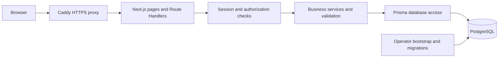

# Design Document

Team #__

This document describes the planned secure incident-reporting application and supports SDL Practice #5. The assignment governs functional and security behavior. OWASP ASVS 5.0.0 Level 2 supplements those requirements. Implementation and verification are pending for the application features described here. [Assignment](../ASSIGNMENT.md) · [Security requirement mapping](asvs/assignment-mapping.md)

## 1. Scope and decisions

The application provides a reporter workflow, a reviewer workflow, and administrator controls for accounts, incident visibility, comments, bounded settings, and categories. It uses Next.js App Router with TypeScript and PostgreSQL. The course deployment runs in Docker. AWS remains a future deployment target. The existing threat model defines the role permissions and entry points used throughout this design. [Architecture decisions and entry points](threat-model.md)

Prisma ORM is selected for database access under the delegated ORM decision. Its typed query interface fits the TypeScript application, and transactions support atomic business changes with audit records. Queries must use parameter binding. Authorization remains explicit in the application, including filters on records and selected response fields. Reviewed migration SQL will be needed for PostgreSQL audit permissions and triggers. The exact Prisma version, adapter, and compatible Node version remain pending package selection. [Prisma query safety](https://www.prisma.io/docs/orm/v7/prisma-client/using-raw-sql/raw-queries) · [Prisma transactions](https://www.prisma.io/docs/orm/v7/prisma-client/queries/transactions)

Caddy is selected as the local HTTPS reverse proxy, as directed by the team. The certificate setup and internal transport details are recorded as open decisions in §9.

## 2. Architecture and responsibilities

| Component | Responsibility |
|---|---|
| Browser UI | Role-specific navigation, forms, readable validation feedback, and logout access. Render incident text as escaped text. |
| Caddy | Local HTTPS entry point and reverse proxy. Forward client identity only through the trusted proxy path. |
| Pages and Route Handlers | Authenticate and authorize each request, including page and RSC reads. Route Handlers own all writes. |
| Session and authorization logic | Resolve the hashed session token, account activity, expiry, current database role, and temporary-password gate. |
| Business services | Enforce validation, incident transitions, account protections, and transactional audit recording. |
| Prisma access layer | Parameterized data access, ownership and status filters, explicit field selection, and transactions. |
| PostgreSQL | Persist application data, relationships, concurrent changes, sessions, and append-only audit history. |
| Operator tools | Bootstrap the first administrator, apply migrations with a separate database owner role, and manage deployment secrets. |

The browser, application, database, and operator plane cross the trust boundaries already documented in the threat model. Input is untrusted until validated at the server. Database credentials for normal operation have restricted permissions. The application must authorize requests independently of middleware. [Trust boundaries and common controls](threat-model.md#12-trust-boundaries)

## 3. Roles and interfaces

| Capability | User | Reviewer | Admin | Entry points |
|---|---|---|---|---|
| Sign in, sign out, change own password | Allowed | Allowed | Allowed | EP-01, EP-02, EP-05, EP-06 |
| Submit an incident | Allowed | Denied | Denied | EP-07 |
| View own report summaries | Allowed | Denied | Denied | EP-19 |
| View incident queue and details | Own summaries only | Open and under-review | All statuses | EP-08, EP-09, EP-19 |
| Change status or classification | Denied | Allowed for accessible incidents | Denied | EP-10, EP-21 |
| Add comments | Denied | Accessible incidents | All incidents | EP-11 |
| Manage accounts and roles | Denied | Denied | Allowed with account safeguards | EP-12 to EP-17 |
| Read audit history | Denied | Denied | Allowed | EP-18 |
| Manage settings and categories | Denied | Denied | Allowed | EP-20, EP-22, EP-23 |

The role matrix follows D-1 to D-3. A user sees title, status, and submission date for their own reports. Reviewers lose access to closed incidents. Administrators can view and comment across statuses. All accounts are prohibited from changing their own role. Account administration also prevents self-deactivation and removal of the last active administrator. [Entry point contracts](threat-model.md#14-entry-point-inventory)

Public interfaces are login, the minimal health endpoint, and static assets (EP-01 to EP-04). Protected requests require a valid active-account session. Missing or invalid sessions yield 401 at the API. Role-based denials yield 403, and inaccessible incident details use the same 404 response as missing records. Unsupported methods yield 405. Exact response bodies remain an open contract detail.

## 4. Data model

The following logical model preserves the stores already identified by the threat model. Physical column types, indexes, constraints, and migration details await review in §9.

| Store | Core data and relationships | Protection |
|---|---|---|
| Users | ID, username, fixed role, active flag, password hash, temporary-password expiry and change flag, failed-login state | Password hashes stay server-side. Role and activity are read for authorization. |
| Sessions | Token hash, user reference, creation, last activity, absolute expiry | Only an opaque random token is held in the browser cookie. |
| Incidents | ID, reporter reference, title, description, status, category reference, timestamps | Queries constrain ownership and reviewer status visibility. |
| Comments | ID, incident reference, author reference, body, creation time | Access follows the parent incident's authorization. |
| Categories | ID, unique name, active flag | Deactivation preserves existing assignments and prevents new assignments. |
| Settings | Bounded configuration, update time, updating actor | Validate on write and read. Invalid stored values use fixed defaults. |
| Audit log | ID, actor, UTC time, action, target | Append-only database permissions and an update/delete rejection trigger. |
| Login attempts | IP, time window, count | Supports shared rate limits across restarts and application instances. |

Incident identifiers are UUIDs as recorded in the threat model. Passwords, session tokens, and secrets are highly sensitive. Descriptions, comments, and roles require restricted access. Lists select only necessary fields and omit descriptions. The first-admin audit actor representation and settings before/after audit metadata need a physical schema decision. [Assets and data sensitivity](threat-model.md#17-assets-and-data-stores)

## 5. Main workflows and consistency

Account creation generates a one-time temporary password, displays it once, and records account creation. First login requires a password change. The temporary-password session is restricted to the password flow, logout, and static assets. Self-service password change requires the current password and offers to end other sessions, selected by default. Admin reset and account deactivation end all target sessions.

Login uses a new cryptographically random session token and stores its hash in PostgreSQL. The cookie uses the `__Host-` prefix, `HttpOnly`, `Secure`, `SameSite=Strict`, and `Path=/`. The design limits accounts to five sessions and ends the oldest at the limit. Default inactivity and maximum lifetimes are 30 minutes and eight hours. Logout deletes the server session and expires the browser cookie. [Session policy D-5](threat-model.md#step-3-what-can-be-done-about-it-mitigations-and-ranking)

An incident begins open and is attributed to the authenticated reporter. Reviewers classify it with an active category, comment, and move it through open → under-review → closed. Each mutation checks the current role and record permissions. Status changes use the expected existing status to reject conflicting updates.

FR-11 actions and the additional settings/category actions commit with their audit record in one transaction. Audit failure rolls back the business mutation. Last-administrator protections must remain correct under concurrent requests. The existing threat model calls for locking within transactions. The exact locking protocol, isolation level, and bounded retry policy require implementation review before account mutations are built (NFR-5, ASVS V2.3.3, V2.3.4).

## 6. Validation, security, and error handling

Strict server schemas reject unknown fields, invalid types, unsupported enums, and out-of-range values. Passwords follow the existing 15–128 character design with an offline common-password check. Title, description, comment, category, username, pagination, and request-body limits require the decisions in §9. Plain text is escaped at rendering. Queries use ORM operations or bound parameters (SR-7, SR-8, ASVS V2.2.1, V2.2.2, V1.2.4).

Writes require an allowed method, JSON content type, and a matching Origin header. A missing Origin is rejected. Responses carry the security headers defined in C-7, including CSP and HSTS. Authenticated responses use `Cache-Control: no-store`. Client storage and URLs must not contain credentials or incident details. [Common controls](threat-model.md#13-common-controls-apply-to-every-non-public-entry-point)

Audit records include actor, timestamp, action, and target. They exclude passwords, tokens, and incident descriptions. Sanitized application logs capture authentication and authorization failures and diagnostic errors. Client errors remain generic and omit SQL and stack traces. Logging failure, storage exhaustion, and retention handling require operational decisions before release (FR-11, FR-12, SR-9 to SR-13, ASVS V16.2.1, V16.2.5, V16.4.2, V16.5.1).

Admin settings retain the existing defaults and limits in threat-model §1.4.1. Hashing parameters, minimum password length, role permissions, cookie flags, security headers, and audit enablement remain fixed security controls. Settings changes are audited with the approved before/after values. [Settings contract](threat-model.md#141-admin-configurable-settings-ep-20)

## 7. Deployment and operation

The local deployment uses Caddy, the Next.js application, and PostgreSQL containers. PostgreSQL stays on the private Docker network with no published host port. The application runs with a restricted database account. Migrations use separate owner credentials. The application image runs as a non-root user, and production uses a production build.

Local secret configuration is encrypted with dotenvx. The decryption key stays outside the repository and container image. Placeholder configuration remains in `.env.example`. AWS deployment would use Secrets Manager and private database networking. Local key storage and injection details remain an open implementation decision under SR-14. [Deployment surfaces and secrets](threat-model.md#16-non-http-surfaces)

The first administrator is created through an operator CLI with a prompted password and an audit event. Seeds use synthetic data and run only through an explicit development operation. Dependency versions and lockfiles are reviewed, and CI performs the selected security checks. Backup, recovery, storage monitoring, and dependency remediation policies remain pending.

## 8. Requirements traceability and verification

All entries describe design coverage. Passing evidence belongs in the security testing report and ASVS checklists after execution.

| Requirement | Design coverage | Planned verification |
|---|---|---|
| FR-1, FR-2, FR-3 | Account administration in §§3–5 | UC-02, UC-07; MC-05, MC-06 |
| FR-4, FR-5 | Login and session lifecycle in §5 | UC-01; MC-01, MC-02 |
| FR-6 | Reporter submission in §§3, 5 | UC-04 |
| FR-7, FR-8 | Reviewer queue and transitions in §§3, 5 | UC-05; MC-07, MC-08 |
| FR-9, FR-10 | Comments and admin visibility in §3 | UC-05, UC-06 |
| FR-11, FR-12 | Transactional, append-only audit in §§4–6 | UC-09; MC-11 |
| FR-13, NFR-1 | Role-specific pages and feedback in §§2–3 | UI workflows UC-01 to UC-09 |
| NFR-2, NFR-6 | Generic errors, transaction rollback, recovery in §§5–7 | MC-10, MC-11; recovery exercise pending |
| NFR-3, NFR-4 | Two-second actions under normal load and at least 50 concurrent users | UC-10; workload and measurement definition pending |
| NFR-5 | Conditional status updates and transactional account protections in §5 | MC-06, MC-08, MC-11 |
| NFR-7, NFR-8 | Component responsibilities and documented contracts in §§2–6 | Design/code review and component documentation |
| NFR-9 | Containerized deployment in §7 | Windows, macOS, and Linux run verification |
| SR-1, SR-3 | Session validation and cookie protection in §§3, 5 | MC-02, MC-03, MC-05 |
| SR-2 | Password hash storage and credential lifecycle in §§4–6 | UC-01 to UC-03; MC-04 |
| SR-4, SR-5, SR-6 | Request-level RBAC, record filters, self-role prohibition in §§3–5 | MC-05 to MC-08 |
| SR-7, SR-8 | Strict schemas, escaped output, bound queries in §6 | MC-06, MC-09, MC-10 |
| SR-9, SR-10, SR-11 | Sanitized logs and protected audit history in §6 | UC-09; MC-11 |
| SR-12, SR-13 | Generic client errors and sanitized diagnostics in §6 | MC-10 |
| SR-14 | Encrypted secrets and separated credentials in §7 | MC-12 |
| SR-16 | Restricted data, secure configuration, and logging in §§3–7 | MC-01, MC-07, MC-09, MC-12, MC-13 |
| CONST-1 to CONST-3, ASSUMP-1, ASSUMP-2 | Secure review, Git/PR workflow, Copilot usage requirement, AI reporting, synthetic fixtures | Source review, AI report, and fixture review |
| AC-1 to AC-5 | Requirement mapping, security checks, SDL records, and demo | Acceptance review, SAST/DAST/manual results, and demo evidence |

The use and misuse plan supplies the referenced cases. SAST, DAST, and manual testing must verify the built application before security requirements can be marked complete. [Use and misuse cases](use-misuse-cases.md) · [Security testing report](security-testing.md) · [SDL tracker](sdl.md)

## 9. Unresolved details for team answers

| ID | Question requiring a decision | Affected area |
|---|---|---|
| Q-01 | Which exact Prisma release, PostgreSQL driver/adapter, Node version, and PostgreSQL image should be pinned? | Dependency compatibility and deployment |
| Q-02 | Which argon2id library and measured hashing parameters should be used? Which offline breached-password list and update process? | SR-2 and login capacity |
| Q-03 | What are the exact schema types, foreign-key deletion rules, indexes, username normalization rules, audit system-actor representation, and settings-change metadata format? | Migrations and audit integrity |
| Q-04 | Which validation library, text/body limits, pagination limits, and public API error format should be used? | SR-7, NFR-2, resource limits |
| Q-05 | What local hostname and certificate trust setup should Caddy use? Is TLS required between Caddy and Next.js, and how are trusted proxy addresses configured? | Local HTTPS and client IP integrity |
| Q-06 | How will dotenvx keys be stored and injected locally, including protection at rest and access controls? | SR-14 |
| Q-07 | How should rate limits, lockout state for unknown usernames, hash concurrency, and cleanup scheduling be implemented and sized? | Enumeration defense and resource limits |
| Q-08 | Which shared locking protocol and retry limits protect the last administrator, concurrent session caps, and one-time temporary-password consumption? What happens on a repeated submission after an uncertain response? | NFR-5 and retry consistency |
| Q-09 | Which SAST/DAST tools, CI gates, vulnerability remediation deadlines, and residual risks does the team approve? | AC-3 and SDL review |
| Q-10 | What normal-load workload and timing boundaries define the two-second requirement? What connection-pool and deployment resource limits support 50 concurrent users? | NFR-3, NFR-4 |
| Q-11 | What backup/restore procedure, recovery objectives, log retention, storage alarms, and logging-outage behavior are required? | NFR-6, SR-11, SR-13 |
| Q-12 | What is the team number for the report? | Deliverable identification |

## Revision history

| Date | Change |
|---|---|
| 2026-11-17 | Drafted design from the assignment and existing threat model. Selected Prisma under delegated authority, recorded the team's Caddy choice, and collected unresolved details for review. |
