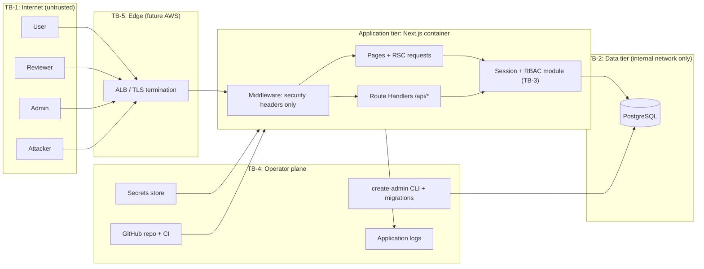
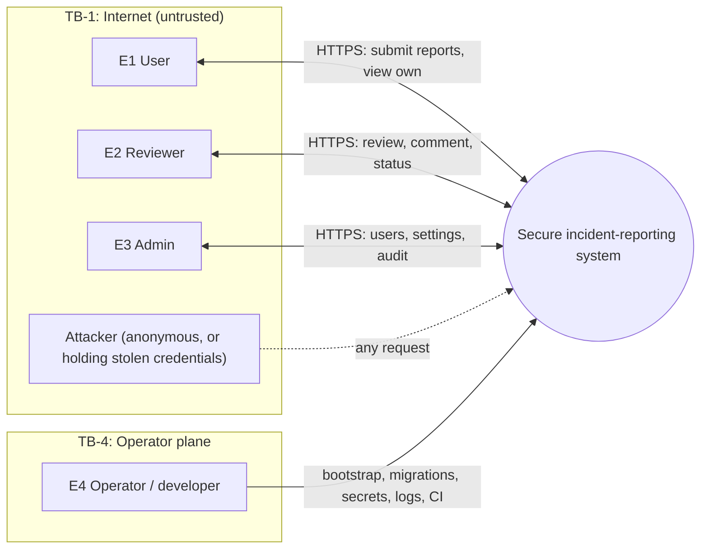
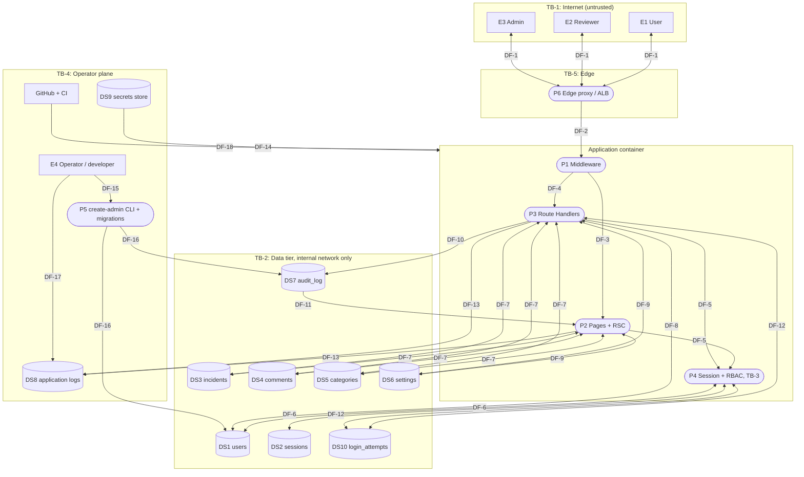

# Threat Model and Attack Surface Analysis

Team #__

Spec: [ASSIGNMENT.md](../ASSIGNMENT.md#submission-requirements)

SDL mapping: Part 1 is **Practice #6, Attack Surface Reduction** (Design phase). Part 2 is **Practice #7, Threat Modeling**. Both are re-checked against the built system in **Practice #13, Threat Model and Attack Surface Review** (Verification phase); see the revision history at the end.

---

## Part 1: Attack Surface Analysis

**Goal:** list every way an attacker could send data into, or get data out of, the system, then remove what isn't needed and tie every remaining entry point to the controls that protect it. The inventory below is also the target list for DAST and the source of the misuse cases in [use-misuse-cases.md](use-misuse-cases.md).

### 1.1 Architecture decisions and assumptions

| ID | Decision | Attack surface effect |
|---|---|---|
| A-1 | Next.js (App Router) + TypeScript, single container. | One app process holds the UI and the backend. |
| A-2 | **PostgreSQL in Docker** for development and the course demo. | Adds a DB network port, which must stay internal. |
| A-3 | **Future deployment to AWS, reachable from the internet** (e.g. ALB + ECS/EC2 + RDS). This analysis treats the internet-facing case as the design target, so nothing has to be redesigned later. | Adds an edge tier, cloud IAM, a managed secrets store and managed logging. |
| A-4 | **Server-side sessions in the database.** The browser holds only an opaque random token in a `__Host-` cookie (`HttpOnly`, `Secure`, `SameSite=Strict`); the DB stores a hash of the token. | Logout (FR-5) and deactivation (FR-3) revoke access at once. No signing key or JWT to protect (ASVS V9 N/A). |
| A-5 | **Route Handlers only** (`app/api/**/route.ts`) for every write. **No Server Actions.** | Every write is an explicit, enumerable endpoint that DAST can reach. |
| A-6 | **Password flow:** admin creates a user or resets a password with a one-time temporary password; the user must change it at next login. Users change their own password with their current password. | Adds one self-service endpoint; removes any email/"forgot password" flow. |
| A-7 | The user's role is read from the database on every request, never from the cookie or client. | Role changes and deactivation take effect immediately; the client can't tamper with its own role. |
| A-8 | No outbound network calls from the server. | No SSRF surface (V1.3.6, V13.2.4). |

### 1.2 Trust boundaries

| ID | Boundary | What crosses it |
|---|---|---|
| TB-1 | Browser / internet ↔ application | All HTTP requests. Everything from the client is untrusted, including headers, cookies, IDs in URLs and hidden fields. |
| TB-2 | Application ↔ PostgreSQL | SQL over the internal network, using the app's DB role. |
| TB-3 | Between privilege levels inside the app (user → reviewer → admin) | Enforced in code by the session and RBAC module on every request. |
| TB-4 | Operator plane ↔ system | Developers and operators: bootstrap CLI, migrations, secrets, logs, CI/CD, container host. |
| TB-5 | (AWS) Edge load balancer ↔ application | TLS termination point; forwarded headers such as `X-Forwarded-For`. |

### 1.3 Common controls (apply to every non-public entry point)

Listed once here so the inventory below can refer to them by ID.

| ID | Control | Requirements |
|---|---|---|
| C-1 | Look up the session server-side from the cookie; reject missing, expired, or deactivated-user sessions with 401. | SR-1; V7.2.1, V7.4.1, V7.4.2 |
| C-2 | Check the role **inside the route handler or page** (from the DB, A-7). Middleware is never the only check (CVE-2025-29927 showed it can be bypassed). | SR-4, SR-5; V8.2.1, V8.3.1 |
| C-3 | Validate the request with a strict schema: known fields only, types, length limits, enums. Unknown fields are rejected, which blocks mass assignment (e.g. sending `role`). | SR-7; V2.2.1, V2.2.2, V15.3.3, V15.3.5 |
| C-4 | State-changing requests use POST/PATCH only and must carry a same-origin `Origin` header (a missing `Origin` is rejected) and `Content-Type: application/json`. Together with `SameSite=Strict` this is the CSRF defense (Route Handlers don't get the built-in Origin check that Server Actions have). | V3.5.1, V3.5.3, V3.3.2 |
| C-5 | ORM or parameterized queries only; no string-built SQL. | SR-8; V1.2.4 |
| C-6 | Generic error responses; details go to server logs. | NFR-2, SR-12, SR-13; V16.5.1, V16.3.4 |
| C-7 | Security headers on every response: CSP with `frame-ancestors 'none'`, HSTS, `nosniff`, `Referrer-Policy`; no CORS headers (same-origin only). | SR-16; V3.4.1 to V3.4.6, V3.4.2 |
| C-8 | Write an audit record for every FR-11 action, plus the D-2 actions (`settings.update`, `category.create`, `category.update`, `incident.classify`) (userId, UTC timestamp, action, targetId; never passwords, tokens, or descriptions). Log failed authentication and authorization attempts to the application logs, not the append-only audit table, so floods can't grow it. | FR-11, SR-9, SR-10; V16.2.1, V16.2.5, V16.3.1, V16.3.2 |
| C-9 | `Cache-Control: no-store` on authenticated responses; return only the fields the role needs (never `password_hash`). | V14.3.2, V15.3.1 |
| C-10 | Object-level check: the requested record (incident, user) must be one this role may act on. IDs are UUIDs, but the check is what protects them. | SR-5; V8.2.2 |
| C-11 | While `must_change_password` is set, only EP-05 and EP-06 (and static assets) are reachable; everything else is refused. Enforced in the shared session module, not per page. | SR-4, SR-5; V6.4.1 |

### 1.4 Entry point inventory

Pages (the UI for all roles, FR-13) are entry points too: each one renders data on the server, and Next.js fetches it again through RSC requests (`?_rsc=`). Each page runs the same C-1/C-2 checks as its API route.

**Sensitivity** uses ASSIGNMENT §6.2: Public, Internal, Sensitive, Highly Sensitive (HS).

| ID | Entry point | Method | Who can reach it | Inputs | Data (sensitivity) | Specific controls | Req |
|---|---|---|---|---|---|---|---|
| EP-01 | `/login` page | GET | Anyone | none | Public, including the admin status message (§1.4.1) | Status message rendered as plain text only (V3.2.2); C-7 | FR-4, FR-13 |
| EP-02 | `/api/auth/login` | POST | Anyone | username, password | Credentials (HS) | Rate limit and lockout backoff per account and IP, with counters in the database (`users.failed_login_count`, `users.locked_until`, `login_attempts`) so they survive restarts and multiple instances; lockout counted by the submitted name even if no such account exists (V6.3.1, V2.4.1); one generic failure message; argon2id verify (SR-2); new session token on login (V7.2.4, V7.2.3); at most 5 sessions per user, oldest ended (V7.1.2); C-4, C-8 | FR-4, SR-2, SR-3 |
| EP-03 | `/api/health` | GET | Anyone | none | Public (§6.2 "system status") | Returns only `{status:"ok"}`; no version, hostname, or DB details (V13.4.5) | NFR-6 |
| EP-04 | `/_next/static/*`, favicon | GET | Anyone | none | Public | Build output only; no production source maps (V15.2.3) | n/a |
| EP-05 | `/api/auth/logout` | POST | Any signed-in role | session cookie | Session token (HS) | Delete the session row, expire the cookie, send `Clear-Site-Data` (V7.4.1, V14.3.1); C-4; link on every page (V7.4.4) | FR-5 |
| EP-06 | `/account/password` page + `/api/account/password` | GET, POST | Any signed-in role, **including a session that must change its temporary password** | currentPassword, newPassword | Credentials (HS) | Current password required (V6.2.3); length 15 to 128, no composition rules, breached/common-password check against a bundled offline list, since A-8 allows no outbound calls (V6.2.1 to V6.2.12); option to end other sessions (V7.4.3); rate limit; C-4, C-8 | FR-11, SR-2 |
| EP-07 | `/incidents/new` page + `/api/incidents` | GET, POST | User | title, description | Title (Internal), description (Sensitive) | C-3 lengths; text rendered with React escaping only, no `dangerouslySetInnerHTML` or Markdown (V3.2.2, V1.3.5); audit record without the description (SR-9) | FR-6, FR-11 |
| EP-08 | `/incidents` queue page + `/api/incidents?status=` | GET | Reviewer (open + under-review), Admin (all statuses) | status filter (enum), page | Titles, statuses (Internal) | Query filtered by role in the data layer, not only in the UI; list view returns no descriptions (V15.3.1); paging limit (V15.2.2) | FR-7, FR-10 |
| EP-09 | `/incidents/[id]` page + `/api/incidents/[id]` | GET | Reviewer (non-closed), Admin (any) | id (UUID) | Description, comments (Sensitive) | C-10; invalid or forbidden id returns the same 404 (no existence oracle) | FR-7, FR-9, FR-10 |
| EP-10 | `/api/incidents/[id]/status` | PATCH | Reviewer | status (enum) | Status (Internal) | Allowed transitions only: open → under-review → closed (V2.3.1); in a transaction with its audit record (V2.3.3, NFR-5); **Admins get 403** (D-3, least privilege); C-4, C-8, C-10 | FR-8, FR-11 |
| EP-11 | `/api/incidents/[id]/comments` | POST | Reviewer, Admin | body | Comment (Sensitive) | C-3 lengths; escaped output; C-4, C-8, C-10 | FR-9, FR-11 |
| EP-12 | `/admin/users` page + `/api/admin/users` | GET | Admin | page | Usernames (Internal), roles (Sensitive) | Never returns hashes, temp passwords, or session data (V15.3.1) | FR-1 to FR-3 |
| EP-13 | `/api/admin/users` | POST | Admin | username, role | Account (Sensitive), temp password (HS) | CSPRNG temporary password shown once, expires after the configured window (default 24 h, §1.4.1) or after first use (V6.4.1, V11.5.1); `mustChangePassword` set; C-4, C-8 | FR-1, FR-2, FR-11 |
| EP-14 | `/api/admin/users/[id]/role` | PATCH | Admin | role (enum) | Role (Sensitive) | **Target ≠ the caller** (SR-6); can't remove the last active admin; C-4, C-8 | FR-2, FR-11, SR-6 |
| EP-15 | `/api/admin/users/[id]/status` | PATCH | Admin | active (boolean) | Account state (Sensitive) | Target ≠ the caller; deactivation deletes all of the target's sessions (V7.4.2, V7.4.5); C-4, C-8 | FR-3, FR-11 |
| EP-16 | `/api/admin/users/[id]` | PATCH | Admin | username | Account (Internal) | Schema allows **only** profile fields; `role`, `active`, and password fields are rejected (V15.3.3, V8.2.3); C-4, C-8 | FR-3 |
| EP-17 | `/api/admin/users/[id]/password-reset` | POST | Admin | none | Temp password (HS) | Same rules as EP-13; ends the target's sessions; audit record "password reset by admin" | FR-3, FR-11 |
| EP-18 | `/admin/audit` page + `/api/admin/audit` | GET | Admin | page, filters (enum/date) | Audit log (Sensitive) | **Read-only; no write, update, or delete route exists**; paging limit; C-9 | FR-11, FR-12, SR-16 |
| EP-19 | `/incidents/mine` page + `/api/incidents/mine` | GET | User | page | Own reports: title, status, submitted date (Internal) | Filtered by `reporter_id = current user` **in the query**, never by a client-supplied id (C-10, V8.2.2); returns no descriptions or reviewer comments (V15.3.1); paging limit | NFR-1 (D-1) |
| EP-20 | `/admin/settings` page + `/api/admin/settings` | GET, PATCH | Admin | the settings in §1.4.1 | Settings (Internal), status message (Public) | Every value checked server-side against the fixed limits in §1.4.1, **out-of-range values rejected, never clamped silently** (V2.2.1, V2.1.3); strict schema, so only listed settings can be changed (V15.3.3); update and its audit record (old → new values) in one transaction (V2.3.3); C-4, C-8 | §1.1/§1.2 (D-2) |
| EP-21 | `/api/incidents/[id]/category` | PATCH | Reviewer | categoryId (UUID) | Category (Internal) | Category must exist and be active; **admins get 403**, same as status (D-3); active categories are listed on the EP-09 page for the dropdown; C-4, C-8, C-10 | §1.2 "classify" (D-2) |
| EP-22 | `/admin/categories` page + `/api/admin/categories` | GET, POST | Admin | name | Category names (Internal) | Unique name, length cap, plain-text rendering (V3.2.2); C-3, C-4, C-8 | D-2 |
| EP-23 | `/api/admin/categories/[id]` | PATCH | Admin | name, active | Category (Internal) | Categories are deactivated, never deleted (R-8); deactivated categories stay on existing incidents but can't be newly assigned; C-3, C-4, C-8 | D-2 |

#### 1.4.1 Admin-configurable settings (EP-20)

Limits are fixed in code, not in the database, so a compromised admin account can't widen them. If the settings row is missing or invalid, the app uses the defaults (fail safe, V16.5.3), never "no limit". Changes take effect on the next request.

| Setting | Default | Allowed range | Requirement |
|---|---|---|---|
| System status message | empty | 0 to 280 characters, plain text | §6.2 "Public: system status messages" |
| Session inactivity timeout | 30 min | 5 to 60 min | V7.1.1, V7.3.1 |
| Session maximum lifetime | 8 h | 1 to 12 h | V7.1.1, V7.3.2 |
| Failed logins before lockout | 5 | 3 to 10 | V6.1.1, V6.3.1 |
| Lockout duration | 15 min | 5 to 60 min | V6.1.1, V6.3.1 |
| Temporary password expiry | 24 h | 1 to 72 h | V6.4.1 |

Incident categories are managed separately (EP-22, EP-23).

**Never configurable at runtime:** password hashing parameters, minimum password length (fixed at 15), cookie flags, security headers and CSP, role permissions (FR-2 fixes the three roles), audit logging on/off or audit retention (FR-12), and database credentials.

Note for Part 2: account lockout can be abused to lock real users out on purpose (STRIDE "D"). Pair it with per-IP rate limiting on EP-02.

### 1.5 Framework and implicit HTTP surfaces

These exist because of Next.js, not because we wrote a route.

| ID | Surface | Risk | Decision / control |
|---|---|---|---|
| FW-1 | Middleware (runs before every request) | Treated as an auth layer, it can be bypassed (CVE-2025-29927). | Used only for security headers and the CSP nonce; requests carrying `x-middleware-subrequest` are rejected. Auth lives in C-1/C-2. |
| FW-2 | RSC / Flight requests on every page | Same data as the page; React Server Components had critical RCE advisories in Dec 2025. | Same checks as the page; pin a patched `next`/`react` and track advisories (V15.1.1, V15.2.1). |
| FW-3 | Server Actions | Hidden public POST endpoints. | **Not used** (A-5). CI fails the build if any file contains `"use server"`. |
| FW-4 | Image optimizer `/_next/image` | SSRF and resource exhaustion if remote images are allowed. | No `remotePatterns`; set `images.unoptimized: true` (V1.3.6, V15.2.2). |
| FW-5 | Error pages, dev overlay, `X-Powered-By` | Stack traces and version disclosure. | Custom `error.tsx` / `not-found.tsx`; `poweredByHeader: false`; never run `next dev` outside a developer machine (V13.4.2, NFR-2). |
| FW-6 | HTTP methods per route | TRACE or unexpected methods. | Each route exports only the methods it needs; others return 405 (V13.4.4, V3.5.3). |

### 1.6 Non-HTTP surfaces

| ID | Surface | Local Docker (course demo) | AWS (future, internet-facing) | Req |
|---|---|---|---|---|
| NH-1 | PostgreSQL port 5432 | Not published to the host: no `ports:` entry in `docker-compose.yml`; internal Docker network only | RDS in a private subnet, "publicly accessible" off; security group allows only the app's security group; TLS required | V12.3.1, V13.2.1 |
| NH-2 | Database roles | **Owner role** (DDL) used only by migrations. **App role** has SELECT/INSERT/UPDATE on app tables and **only INSERT + SELECT on `audit_log`**; plus a trigger rejecting UPDATE/DELETE on `audit_log` as a second layer. No superuser, no default passwords. | Same, with credentials in Secrets Manager | FR-12, SR-11; V13.2.2, V13.2.3, V16.4.2 |
| NH-3 | Secrets (DB passwords for both roles) | Encrypted with dotenvx; private key outside the repo and image (D-4 resolved) | AWS Secrets Manager, read by the task's IAM role only | SR-14; V13.3.1, V13.3.2 |
| NH-4 | First-admin bootstrap | One-time CLI (`npm run create-admin`) run inside the container; prompts for the password. Writes a `user.create` audit record with actor `system`. No web setup page and no seeded default admin. | Run as a one-off task | V6.3.2 |
| NH-5 | Migrations and seed data | Seeds contain only fake data and never run in production | Migrations run as a separate job with the owner role | ASSUMP-2 |
| NH-6 | Application logs (stdout) | Readable by whoever has container access; JSON format; newlines and control characters encoded | CloudWatch Logs with restricted IAM read access and retention; a separate system from the app (V16.4.3) | SR-9, SR-13; V16.2.4, V16.4.1 |
| NH-7 | Container image and host | Runs as non-root; `.dockerignore` excludes `.git`, `.env*`, tests | Same image; no SSH (use SSM Session Manager) | V13.4.1, V15.2.3 |
| NH-8 | Supply chain: npm packages, GitHub repo, CI, Copilot output | Committed lockfile, `npm ci`, `npm audit` / Dependabot; branch protection and PR review on `main`; every AI change reviewed and logged in AI-USAGE-REPORT.md | Same | CONST-2, CONST-3; V15.1.1, V15.1.2, V15.2.1 |
| NH-9 | Browser-side state | Only the session cookie; nothing in localStorage/sessionStorage | Same | V14.3.3 |
| NH-10 | Edge tier (ALB/CloudFront) | n/a (local TLS proxy recommended for DAST, see D-7) | TLS 1.2+ only; HTTP→HTTPS redirect for pages only; app trusts `X-Forwarded-For` only from the ALB (affects rate limiting); optional AWS WAF | V12.1.1, V12.2.1, V4.1.2, V4.1.3, V15.3.4 |

### 1.7 Assets and data stores

| Store | Fields | Highest sensitivity | Who can read through the app |
|---|---|---|---|
| `users` | id, username, role, active, must_change_password, password_hash (argon2id), temp_password_expires_at, failed_login_count, locked_until | HS (hash) | Admin (never the hash) |
| `sessions` | token_hash, user_id, created_at, last_seen_at, expires_at | HS | Nobody through an endpoint |
| `incidents` | id, title, description, status, category_id, reporter_id, timestamps | Sensitive (description) | Reviewer, Admin; the reporter sees only title, status, and date of their own reports (EP-19) |
| `comments` | id, incident_id, author_id, body, created_at | Sensitive (classified like descriptions) | Reviewer, Admin |
| `audit_log` | id, user_id, action, target_id, created_at (UTC) | Sensitive; **integrity-critical** | Admin (read-only) |
| `login_attempts` | ip, window_start, count (per-IP rate limiting) | Internal | Nobody through an endpoint |
| `settings` | the §1.4.1 values, updated_at, updated_by | Internal (status message Public) | Admin; status message shown publicly on EP-01 |
| `categories` | id, name, active | Internal | Reviewer (active only), Admin |
| DB credentials | owner and app role passwords | HS | Nobody through an endpoint |

### 1.8 Attack surface reduction decisions

| ID | Removed or limited | Why | ASVS effect |
|---|---|---|---|
| R-1 | No self-registration | FR-1: admins create accounts | Removes an anonymous write endpoint |
| R-2 | No "forgot password" or email reset; admin reset instead (EP-17) | No mail server, no reset tokens to steal or guess | V1.3.11, V6.5.x, V6.6.x N/A |
| R-3 | No file uploads or attachments | Not required by any FR | V5 N/A |
| R-4 | No OAuth/OIDC, no JWTs | Local username/password + DB sessions (A-4) | V9, V10, V6.8 N/A |
| R-5 | No GraphQL, no WebSockets | Not needed | V4.3, V4.4 N/A |
| R-6 | No Server Actions | A-5 | FW-3 |
| R-7 | No remote images or image optimization | No external content needed | FW-4 |
| R-8 | **No DELETE endpoints at all** | Users are deactivated (FR-3), incidents are closed (FR-8), the audit log is append-only (FR-12) | Smaller tampering surface |
| R-9 | Admin configuration limited to the bounded settings in §1.4.1 plus categories; nothing security-critical is configurable at runtime | D-2 | A compromised admin account can't turn security controls off |
| R-10 | No CORS; same-origin only | No third-party clients | V3.4.2 satisfied by absence |
| R-11 | Database never published outside the internal network | NH-1 | |
| R-12 | Health check returns no version or environment details | EP-03 | V13.4.5 |
| R-13 | No source maps, debug mode, or dev server in deployed builds | FW-5 | V13.4.2, V15.2.3 |
| R-14 | Users see only a list of their own reports (title, status, date); no incident detail, descriptions, or reviewer comments | D-1: feedback for usability (NFR-1) with the least data needed | Limits the IDOR surface to one query-scoped list (EP-19) |
| R-15 | No outbound calls from the server | A-8 | V1.3.6, V13.2.4, V15.3.2 |

### 1.9 Attack surface summary (baseline for Practice #13)

| Reachable by | Entry points | Of which state-changing |
|---|---|---|
| Anyone (unauthenticated) | 4 (EP-01 to EP-04) | 1 (EP-02 login) |
| Any signed-in role | 2 (EP-05, EP-06) | 2 |
| User | 2 (EP-07, EP-19) | 1 |
| Reviewer and/or Admin | 5 (EP-08 to EP-11, EP-21) | 3 |
| Admin only | 10 (EP-12 to EP-18, EP-20, EP-22, EP-23) | 8 |
| **Total** | **23** | **15** |

The highest-risk entry points, which should get the most attention in the STRIDE analysis and testing, are **EP-02** (anonymous, takes credentials), **EP-06** (changes credentials), **EP-13/14/17** (privilege and credential changes), **EP-20** (changes security-relevant settings), and **EP-09/10/19** (object-level access to incident data).

At Practice #13, compare the built app's actual routes (`app/**/route.ts` and pages) against this table. Any new route needs a row here and a threat entry in Part 2 before it merges.

### 1.10 Open items (team decisions)

| ID | Question | Recommendation / resolution |
|---|---|---|
| D-1 | Can users see the incidents they submitted? No FR requires it, but NFR-1 (usability) suggests feedback. | **Resolved 2026-11-10: yes.** Added EP-19, a "My reports" list (title, status, date only) scoped to the current user in the query. |
| D-2 | §1.1/§1.2 say admins manage "system configuration", but no FR defines it. | **Resolved 2026-11-10: option B.** Bounded settings page (EP-20, §1.4.1) and incident categories (EP-21 to EP-23). The settings, the category list, and classification go beyond the FRs; record them in the design doc. |
| D-3 | Can admins change incident status? FR-8 names only reviewers. | **Resolved 2026-11-10: no.** Only reviewers change status (FR-8); admins can view (FR-10) and comment (FR-9). EP-10 returns 403 to admins. |
| D-4 | **SR-14 conflict:** AGENTS.md says secrets live in `.env*`, but SR-14 says secrets must not be stored unencrypted. A plaintext `.env` fails SR-14. | **Resolved 2026-11-14: dotenvx** (see Part 2, Step 3). Encrypted `.env` committed, key outside the repo; AWS: Secrets Manager. AGENTS.md rule updated. |
| D-5 | Session lifetimes and concurrent sessions (V7.1.1, V7.1.2, V7.3.1, V7.3.2) | **Resolved 2026-11-14.** Defaults and ranges are in §1.4.1; the justification and the concurrent-session policy (max 5 per user) are in Part 2, Step 3. |
| D-6 | ORM / query layer (AGENTS.md TODO) | **Carried to #8 (Use Approved Tools).** Prisma or Drizzle; ban the raw "unsafe" query APIs (e.g. `$queryRawUnsafe`) with a lint or CI grep (SR-8). |
| D-7 | TLS locally. Browsers allow `Secure` cookies on `http://localhost`, but DAST and the demo should mirror production. | **Carried to #8 / #11.** Put a local TLS reverse proxy (e.g. Caddy) in `docker-compose.yml` so cookies, HSTS, and redirects behave as they will on AWS. |

---

## Part 2: Threat Model

The four threat modeling questions (Lesson 12). The full STRIDE table is in [stride.md](stride.md).

### Step 1: What are we building? (data flow diagrams)

Element IDs below (E, P, DS, DF) are the ones [stride.md](stride.md) uses. Trust boundaries TB-1 to TB-5 are defined in §1.2.

**Level 0 (context)**

**Level 1**

**Elements**

| ID | Type | Element | Refs |
|---|---|---|---|
| E1, E2, E3 | External entity | User, Reviewer, Admin | §1.4 |
| E4 | External entity | Operator / developer | TB-4 |
| P1 | Process | Middleware (security headers and CSP nonce only) | FW-1, C-7 |
| P2 | Process | Pages and RSC rendering | FW-2, EP-01, EP-06 to EP-09, EP-12, EP-18 to EP-20, EP-22 |
| P3 | Process | Route Handlers (`app/api/**`) | EP-02, EP-05 to EP-23 |
| P4 | Process | Session and RBAC module (C-1, C-2, C-10, C-11) | TB-3 |
| P5 | Process | `create-admin` CLI and migrations | NH-4, NH-5 |
| P6 | Process | Edge proxy: local Caddy, AWS ALB | NH-10, TB-5 |
| DS1 to DS7 | Data store | `users`, `sessions`, `incidents`, `comments`, `categories`, `settings`, `audit_log` | §1.7 |
| DS8 | Data store | Application logs | NH-6 |
| DS9 | Data store | Secrets store (dotenvx, Secrets Manager) | NH-3 |
| DS10 | Data store | `login_attempts` (per-IP rate-limit counters) | EP-02 (DC-4) |

**Data flows**

| ID | Flow | Carries | Crosses |
|---|---|---|---|
| DF-1 | Browser ↔ Edge | All HTTP requests and responses (EP-01 to EP-23) | TB-1, TB-5 |
| DF-2 | Edge → Middleware | Forwarded request, `X-Forwarded-For` | TB-5 |
| DF-3 | Middleware → Pages/RSC | Page and `?_rsc=` requests (FW-2, FW-4, FW-5) | |
| DF-4 | Middleware → Route Handlers | `/api/*` requests (FW-6) | |
| DF-5 | Pages/Handlers → Session + RBAC | Cookie token, role and object checks | TB-3 |
| DF-6 | Session + RBAC ↔ users, sessions | Token hash lookup, role, `active` flag | TB-2 |
| DF-7 | App ↔ incidents, comments, categories | EP-07 to EP-11, EP-19, EP-21 to EP-23 | TB-2 |
| DF-8 | Handlers ↔ users | EP-06, EP-13 to EP-17 | TB-2 |
| DF-9 | App ↔ settings | EP-20; status message on EP-01; limits read by P4 | TB-2 |
| DF-10 | Handlers → audit_log | Append-only records (C-8) | TB-2 |
| DF-11 | audit_log → Admin audit page | EP-18, read-only | TB-2 |
| DF-12 | App ↔ login_attempts | EP-02 rate limit and lockout | TB-2 |
| DF-13 | App → application logs | JSON logs on stdout (NH-6) | |
| DF-14 | Secrets store → App | DB credentials at startup (NH-3) | TB-4 |
| DF-15 | Operator → CLI / migrations | NH-4, NH-5 | TB-4 |
| DF-16 | CLI / migrations → database | Owner role, first admin, schema (NH-2) | TB-4, TB-2 |
| DF-17 | Operator → reads logs | NH-6 | TB-4 |
| DF-18 | GitHub / CI → container image | Code, dependencies, image build (NH-7, NH-8) | TB-4 |

### Step 2: What can go wrong? (STRIDE)

Done in [stride.md](stride.md): 64 threats, **12 High**, 47 Medium, 5 Low. Every element has a threat or an N/A reason (coverage table there). Threats include the two flagged in Part 1: lockout abuse (T-03) and plaintext secrets (T-53).

### Step 3: What can be done about it? (mitigations and ranking)

Each threat in [stride.md](stride.md) lists its mitigations (C-x, SR/FR, ASVS) and a DREAD score.

**Bug bar** (SDL Practice #3, [sdl.md](sdl.md)): DREAD average of 7.0 or more is High and must be mitigated and tested before release. Authentication bypass, privilege escalation, SQL injection, and audit tampering are High regardless (`*`). Medium must be mitigated or carry an accepted risk. The team has not yet confirmed the bug bar.

**High threats**

| ID | Threat | Avg | Key mitigations |
|---|---|---|---|
| T-19 | Vertical privilege escalation: a user or reviewer calls admin endpoints (or an admin calls reviewer-only ones) by forced browsing. | 7.6 | Role checked from the DB inside every handler and page, deny by default; see [stride.md](stride.md) |
| T-01 | Credential stuffing or brute force on login takes over an account (an admin account means full control). | 7.4 | Per-account and per-IP rate limit; see [stride.md](stride.md) |
| T-24 | IDOR: a reviewer reads a closed incident, or a user reads others' reports, by changing an ID or `reporter_id`. | 7.4 | Object-level check inside the query (C-10); see [stride.md](stride.md) |
| T-44 | A Next.js or React vulnerability (e.g. the Dec 2025 RSC RCE) gives code execution or an auth bypass. | 7.4 | Pinned patched versions; see [stride.md](stride.md) |
| T-29 | Stored XSS in an incident title, description, comment, category name, or username steals a reviewer or admin session. | 7.2 | React escaping only; see [stride.md](stride.md) |
| T-38 | SQL injection through filters, IDs, status values, or text input. | 7.2 | ORM or parameterized queries only; see [stride.md](stride.md) |
| T-52 | PostgreSQL is published to the host or the internet (compose `ports:`, public RDS), letting an outsider attack the database directly. | 7.2 | No `ports:` on the DB service (CI check); see [stride.md](stride.md) |
| T-53 | DB credentials are stored or committed in plaintext (`.env`), or tampered with (D-4, SR-14). | 7.2 | dotenvx: encrypted `.env` committed, `.env.keys` gitignored and `.dockerignore`d, private key injected at runtime; see [stride.md](stride.md) |
| T-17 | Mass assignment: the client sends `role`, `active`, or hash fields to a profile, password, or incident endpoint. | 6.8* | Strict schema rejecting unknown fields (C-3); see [stride.md](stride.md) |
| T-33 | The audit log is altered or deleted by SQL injection, a compromised app, or an insider. | 6.8* | App DB role has INSERT and SELECT only; see [stride.md](stride.md) |
| T-43 | Middleware bypass (CVE-2025-29927, `x-middleware-subrequest`) skips authentication or headers. | 6.6* | No auth in middleware (C-2); see [stride.md](stride.md) |
| T-18 | An admin changes their own role or deactivates themself, or removes or deactivates the last active admin. | 6.0* | Target must differ from the caller (SR-6); see [stride.md](stride.md) |

Medium and Low threats are in [stride.md](stride.md). Accepted residual risks AR-1 to AR-7 are listed there. Six design changes (DC-1 to DC-6) came out of this pass and are applied to Part 1.

**D-4 resolved (SR-14): dotenvx.** The encrypted `.env` is committed. The private key lives in a gitignored `.env.keys` locally, or is injected as `DOTENV_PRIVATE_KEY` at runtime; it is never in the repo, the image, or a build argument. `.env.example` keeps placeholders. Secret scanning runs in CI. On AWS, credentials come from Secrets Manager through the task's IAM role. Owner and app database credentials are separate. Residual risk: AR-5. The `AGENTS.md` rule is updated.

**D-5 resolved (sessions, V7.1.1, V7.1.2).**

| Item | Decision | Why |
|---|---|---|
| Inactivity timeout | 30 min default, 5 to 60 min allowed | Matches NIST SP 800-63B (rev. 3) AAL2 guidance of 30 min idle; the admin-only range is bounded and audited (T-21). |
| Absolute lifetime | 8 h default, 1 to 12 h allowed | One working day; AAL2 allows up to 12 h. |
| Concurrent sessions | Allowed, at most 5 per user; the oldest is ended at the limit | Supports several devices while bounding table growth (T-12). |
| Password reset by admin, deactivation | End all of the user's sessions | Lost-credential and revoked-access cases (V7.4.2, V7.4.5). |
| Password change by the user | Offer to end other sessions, checked by default | V7.4.3. |

### Step 4: Did we do a good job? (validation)

Another engineer is writing [use-misuse-cases.md](use-misuse-cases.md) and [security-testing.md](security-testing.md). This is the handoff: every High threat has a misuse case suggestion, and so do the Medium threats that match the demo scenes or the CSRF, lockout, and enumeration cases.

| Threat | Suggested misuse case | Test type |
|---|---|---|
| T-01 (High) | Attacker brute-forces a reviewer's password | Automated test (lockout after N) + DAST |
| T-02 (Medium) | Attacker enumerates valid usernames | Automated test (response and timing parity) |
| T-03 (Medium) | Attacker locks a real user out | Automated test |
| T-08 (Medium) | Attacker replays a stolen session after logout | Automated test + DAST |
| T-09 (Medium) | Malicious page forges a status change | DAST + automated test |
| T-17 (High) | User sends `role: admin` in a request body | Automated test + DAST |
| T-18 (High) | Admin tries to demote themself or the last admin | Automated test |
| T-19 (High) | User calls an admin endpoint | Automated role matrix + DAST authz scan + manual |
| T-21 (Medium) | Admin submits an out-of-range setting | Automated test |
| T-24 (High) | User reads another user's incident by ID | Automated test + DAST authz scan + manual |
| T-26 (Medium) | Admin tries to close an incident | Automated test |
| T-29 (High) | Reporter plants a script in an incident description | SAST (lint ban) + DAST + manual |
| T-33 (High) | Admin tries to edit or delete audit entries | Automated DB test + DAST + manual |
| T-38 (High) | Attacker injects SQL through the status filter | SAST + DAST (ZAP SQLi) + manual |
| T-43 (High) | Attacker sends the middleware-bypass header | DAST + automated test |
| T-44 (High) | App runs a Next.js or React version with a known critical advisory | SCA (`npm audit`, Dependabot) in CI |
| T-50 (Medium) | Attacker spoofs `X-Forwarded-For` to dodge the rate limit | Automated test |
| T-52 (High) | Outsider scans for and connects to PostgreSQL | Automated compose check + manual port scan |
| T-53 (High) | Attacker looks for credentials in the repo or image | Secret scan (gitleaks) in CI + manual |

**Demo video scenes** (assignment examples): logging in as a user with higher privileges and calling an admin endpoint (T-19, T-17); outside attempts to reach the database (T-52); an action the user isn't authorized for, such as reading another user's incident (T-24) or an admin closing an incident (T-26); tampering with the audit log (T-33).

**Done when:**

- [x] Every DFD element has STRIDE entries or an N/A reason ([stride.md](stride.md), coverage table).
- [x] Every threat has a mitigation or an accepted risk.
- [x] D-4 and D-5 are resolved.
- [ ] Every High threat has a misuse case in `use-misuse-cases.md` and a planned test in `security-testing.md` (another engineer).
- [ ] Team review of DREAD scores and the bug bar; AI usage logged in AI-USAGE-REPORT.md.

Practice #13 re-checks all of this against the built system.

---

## Revision history

| Date | SDL practice | Change |
|---|---|---|
| 2026-11-10 | #6 Attack Surface Reduction | Initial attack surface analysis (AI-drafted; see AI-USAGE-REPORT.md). |
| 2026-11-10 | #6 Attack Surface Reduction | Resolved D-1 (added EP-19) and D-3 (admins can't change status). |
| 2026-11-10 | #6 Attack Surface Reduction | Resolved D-2 option B: added EP-20 to EP-23, §1.4.1 settings limits, `settings` and `categories` stores; updated R-9 and counts. |
| 2026-11-14 | #7 Threat Modeling | Part 2: DFDs, STRIDE analysis (`stride.md`), DREAD and bug bar, D-4 and D-5 resolved. Design changes from the analysis applied to Part 1: C-11, C-4 and C-8 tightened, EP-02, EP-06, FW-1, NH-3, NH-4, and §1.7 (`login_attempts`). |
